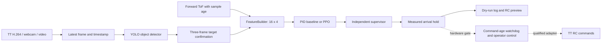

# Camera-to-command architecture

The first demonstration recognizes a stationary printed object on a wall in normal indoor light. The laptop performs inference and control; the TT provides video, flight stabilization and forward range through its expansion board. Person following, night flight and neural inference on the expansion board are outside this milestone.

## Detection and target selection

YOLO11n is a reproducible pretrained baseline, not a claim that it is the newest or best detector. Select two or three object classes after testing the actual wall prints. Pretrained weights may be enough; collect a small benchmark before deciding to fine-tune. An ArUco marker or red card does not require training. Those adapters are optional bench fixtures and output the same normalized `Detection` structure.

A detection contains normalized center, width, height, confidence, class, source frame ID and timestamp. `TargetLock` requires three distinct input frames and same-class overlap/proximity before selecting a target. Missing targets reset confirmation. This is object association, not personal identity recognition. Host decode timestamps do not measure camera exposure time.

## Mapping detections to movement

For frame width W and box center cx in pixels:

- `ex = cx / W - 0.5`: positive means the target is to the right.
- `ey = cy / H - 0.5`: positive means it is below the image center.
- `d_visual = visual_scale_m / box_height_fraction`: a per-print, per-camera calibrated distance proxy.
- Forward distance uses fresh associated ToF when available; otherwise it uses visual scale while outside the near-range gate.

The PD baseline computes normalized forward/yaw proposals from errors `[distance - 0.65, ex]`. Its starting gains are proportional `[1.5, 3.5]`, derivative `[0.08, 0.05]` and zero integral; `PIDGains` makes them configurable, and the October 31 [tuned candidate](../configs/pid_gains_tuned.json) selected on validation seeds uses proportional `[4.0, 2.0]`, derivative `[0.2, 0.15]` and zero integral, see [CONTROLLER_TUNING.md](CONTROLLER_TUNING.md). It resets the derivative at a visual/ToF handover. A PPO policy proposes the same two normalized actions.

| Situation | Result after supervision |
|---|---|
| Target right / left | Positive / negative yaw turns toward it; verify sign on hardware |
| Horizontal error exceeds 0.12 or vertical error exceeds 0.15 | Forward output becomes zero while alignment is corrected |
| Centered, far, valid input | Bounded forward approach |
| Fresh raw range at or below 0.40 m | All channels become zero, even without target association |
| Near-range latch set and range unavailable | Hold; a later far-looking box does not clear the latch |
| Missing/stale target, invalid values, operator stop or bad telemetry | All channels become zero |
| Fresh associated range within 0.08 m of 0.65 m and abs(ex) below 0.05 | Zero output during a continuous two-second measured hold; arrival then latches until reset |

The SDK channel order is `[left_right, forward_back, up_down, yaw]`:

`rc = [0, round(20 * safe_forward), 0, round(25 * safe_yaw)]`

There is no reverse, lateral or vertical policy action. RC values are channel inputs, not measured m/s. The supervisor bounds each action, limits changes and applies a provisional near-wall braking margin. A zero command requests a hold; it does not guarantee an instantaneous physical stop.

## One policy interface

`core.py` defines `objectpilot-v1-16x4`: 16 fixed-scale features stacked across four chronological control ticks, with zero-padded initial history. `interfaces.md` lists exact indices. Simulator, replay, marker adapters and the future dispatcher use this contract. Checkpoint loading verifies schema, behavior version, ordered features, action names, complete Config and actual tensor spaces. `objectpilot-control-v2` adds identical target confirmation and `ControlGate` behavior to simulation and replay, including zero commands during arrival hold. Simulator truth only audits terminal physical success. Integer RC quantization and cap changes also affect simulated dynamics. Old checkpoints must be retrained; see [the TT audit](TT_CONTROL_AUDIT.md). The earlier 11-input reference environment is not deployed.

## Timing, video and future flight dispatch

`video.py` keeps only the latest decoded frame. File replay uses video seconds; live capture uses host monotonic time. Range sidecars can only accompany files, and timestamps must be sorted and finite. The video path never fabricates a synchronized camera exposure timestamp.

`GroundLink` permits only SDK/video initialization and range/version queries. It cannot send takeoff, landing or RC commands. The public replay and collection commands are therefore ground-only.

`CommandDispatcher` is an integration scaffold, not a flight launcher. With a qualified injected adapter it supervises command age, operator heartbeat, battery and height independently of inference. It accepts the canonical output/configuration only, zeroes expired commands, latches one landing request on a sustained fault and does not interpret that request as a confirmed landing. The sink must provide bounded, nonblocking I/O; onboard link-loss behavior must be tested because a disconnected PC cannot deliver a land command.
